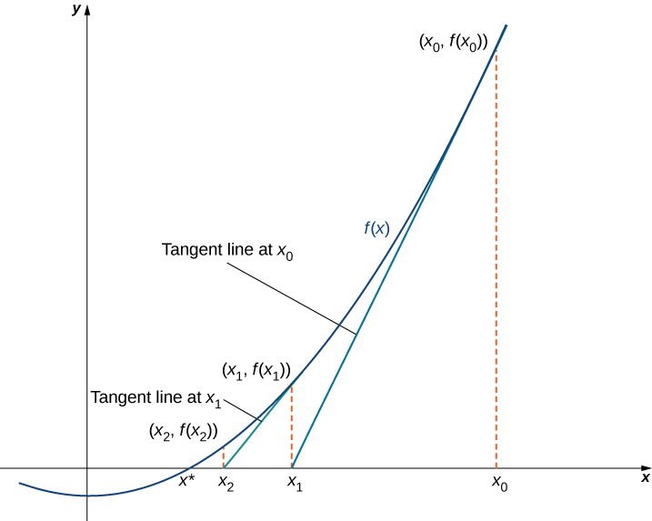

# **Examen C/C++**

Durée : 1h30 – Documents autorisés

## **Exercice 1 : Méthode numérique de Newton-Raphson**

La méthode de Newton-Raphson est une méthode numérique permettant de calculer la racine d'une fonction, c'est-à-dire déterminer x tel que f(x) = 0. Elle consiste à calculer les valeurs successives d’une suite xn d’approximation de f(xn) = 0 telle que xn+1 = xn – f(xn) / f’(xn) avec f’ la dérivée de f. Le critère d’arrêt est défini par la précision p telle que f(xn) / f’(xn) \< 10-p

1. Soit une fonction polynomiale f(x) comme par exemple f(x) = x3 – 2x – 5. Créer une classe

Polynome comportant deux paramètres (degré du polynôme et tableau des coefficients réels) avec son constructeur.

2. Ajouter une méthode permettant de calculer la valeur du polynôme pour une valeur x

passée en paramètre.

3. La méthode Newton-Raphson nécessite le calcul au préalable de la fonction dérivée de

f(x), c’est-à-dire f’(x) = 3x2 – 2 dans l’exemple pris ci-dessus. Cette dérivée peut être estimée numériquement par la relation f’(x) = (f(x+h) – f(x-h))/(2h) avec h petit. Ecrire la méthode fprime qui calcule la dérivée de la fonction f à partir des valeurs x et h passées en paramètres.

4. Écrire la méthode Newton-Raphson permettant de calculer et d’afficher les valeurs

successives de la suite xn à partir d’une valeur initiale x0 passée en paramètre et d’une précision p passée également en paramètre. Attention, puisque rien ne garantit que l’algorithme converge à partir d’une valeur x0 quelconque, il est indispensable de rajouter une condition d’arrêt à l’algorithme (par exemple sortie de la fonction après 10 itérations) pour éviter une boucle sans fin.

## **Exercice 2 : Gestion d’un parc de voitures de locations**

Le sujet de l’examen concerne la gestion d’un parc de voitures de locations. Un parc de voitures possède 4 caractéristiques : nom du loueur, adresse du loueur, parc de voitures (sous la forme d’un tableau), ensemble des réservations (sous la forme d’un tableau) Ex : Europcar situé à Dijon possède un parc de 100 voitures. Une Voiture est définie par les caractéristiques suivantes : marque, modèle, immatriculation, type de voiture (économique, compacte, monospace), état (disponible, non disponible) Ex : La Citroën C3 immatriculée AB-123-CD est un véhicule disponible de type économique. Une Réservation permet à un client de louer une voiture si elle est actuellement disponible (pour des raisons de simplicité, les dates de location ne sont pas gérées). Une Réservation est donc définie par les 3 caractéristiques suivantes : identifiant numérique de réservation, nom du client, numéro d’immatriculation de la voiture louée Ex : D. Ginhac a effectué la réservation 103 en louant la voiture immatriculée AB-123-CD.

1. Ecrire le code de la classe Voiture avec son constructeur. 2. Dans la classe Voiture, surcharger l’opérateur \<\< pour afficher les caractéristiques d’une

voiture.

3. Ecrire le code la classe Réservation avec son constructeur. 4. Dans la classe Réservation, surcharger l’opérateur \<\< pour afficher les caractéristiques

d’une réservation.

5. Ecrire le code de la classe Loueur avec son constructeur avec un parc de véhicules

initialement vide et un ensemble de réservations initialement vide.

6. Ecrire le code de la méthode permettant d’ajouter un véhicule au parc. Attention, avant

d’ajouter une voiture, vous devez vous assurer que la voiture n’est pas déjà référencée dans le parc. Afficher un message d’erreur si nécessaire.

7. Ecrire le code de la méthode permettant de supprimer un véhicule du parc à partir de son

immatriculation. Attention, avant de supprimer une voiture, vous devez vous assurer que la voiture existe bien dans le parc. Afficher un message d’erreur si nécessaire.

8. Ecrire le code de la méthode permettant d’ajouter une réservation d’un véhicule à partir

de son immatriculation. Attention, avant d’ajouter la réservation, vous devez vous assurer que le véhicule existe et qu’il est bien disponible. Afficher un message d’erreur si nécessaire.

9. Ecrire le code de la méthode permettant de restituer un véhicule réservé à partir de son

immatriculation. Attention, avant de supprimer la réservation, vous devez vous assurer que le véhicule existe et qu’il a bien été réservé. Afficher un message d’erreur si nécessaire.

10. Dans la classe Loueur, surcharger l’opérateur \<\< pour afficher les caractéristiques

complètes du parc.
