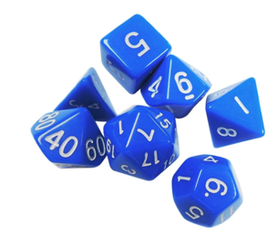

# Rattrapage Programmation C++ - Année 2022/2023

Durée : 45 min - Documents papiers autorisés

> Attention : Vous veillerez à écrire du code le plus propre possible respectant les règles présentées en cours. Notamment, vous ferez attention à nommer explicitement vos variables, vos fonctions ou vos méthodes, à utiliser à bon escient les références, à utiliser correctement le mot clé « const » dès que nécessaire, …

## « Lançons les dés »

On se propose de créer une classe De qui sera utilisée pour jouer à des jeux de dés.



Un dé standard est un cube dont les faces sont numérotées de 1 à 6. De nombreuses variations existent allant du dé à 2 faces, jusqu’à 100 faces. Le lancer de dé sera simulé en tirant un nombre aléatoire entre 1 et le nombre de faces avec la fonction std ::rand(). Pour information, la fonction std ::rand() renvoie un nombre entier compris entre 0 et 231-1.

**Question 1** (4 points ) - Créer une classe De simulant le lancer d’un dé à n faces (valeur par défaut égale à 6) et permettant d’exécuter le code suivant :

```
    De d1;                  // Création d’un dé d1 à 6 faces (valeur par défaut)
    De d2(10);              // Création d’un dé d2 à 10 faces
    int l1 = d1.lancer()    // Lancer du dé d1 (l1 contient une valeur entre 1 et 6)
    int l2 = d2.lancer()    // Lancer du dé d2 (l2 contient une valeur entre 1 et 10)
```

Attention, la classe De doit être MINIMALE et ne doit permettre que d’exécuter le code ci-dessus.

**Question 2** (5 points) - On se propose d’étendre les fonctionnalités de la classe Dé en lui donnant la possibilité de faire des lancers multiples et de calculer la somme de ces lancers. Par exemple, pour nb=3 lancers successifs ayant donné 4, 5 et 2, on obtient 4+5+2=11. Écrire le code de la méthode somme_des_lancers(int nb) permettant d’exécuter le code suivant :

```
    int somme = d1.somme_des_lancers(3)      // Somme de 3 lancers du dé d1
```

**Question 3** (5 points) - On souhaite maintenant obtenir l’ensemble des valeurs des dés lors des lancers multiples plutôt que leur somme. Par exemple, on souhaiterait obtenir 4, 5, et 2 plutôt que la somme égale à 11. Écrire le code de la méthode valeurs_des_lancers(int nb) permettant d’obtenir la liste des différents lancers. Vous justifierez votre choix concernant le stockage des différents lancers (type XXX à définir dans l’exemple ci-dessous).

```
    XXX valeurs = d1.valeurs_des_lancers(3)    // Trois valeurs des lancers du dé d1
```

**Question 4** (6 points) - On se propose de créer un jeu basique à base de N dés et M lancers. Le principe du jeu est très simple : à chaque lancer, on élimine la plus petite des valeurs en la remplaçant par une nouvelle valeur de dé. Par exemple, avec 5 dés, si on obtient 4 5 2 3 6, on éliminera le 2 en le remplaçant par un nouveau lancer du dé. Si on obtient 4, on aura donc 4 5 4 3 6. A l’itération suivante, on élimine le 3 et on relance le dé. Si on obtient 1 à ce nouveau lancer, on aura 4 5 4 1 6, et ainsi de suite jusqu’au dernier lancer. Ecrire le code de la fonction min qui permet de trouver la valeur minimum d’un lancer de plusieurs dés. Utiliser cette fonction pour écrire ensuite la fonction jeu qui permet de simuler ce jeu.

```
    XXX valeurs = jeu(d1, 5, 3)      // 3 lancers de 5 dé d1, type XXX à définir
```
